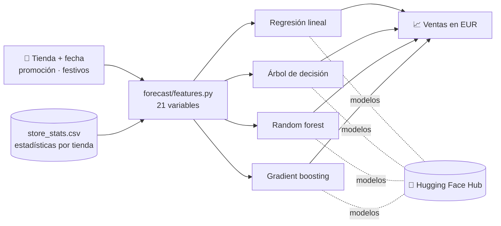
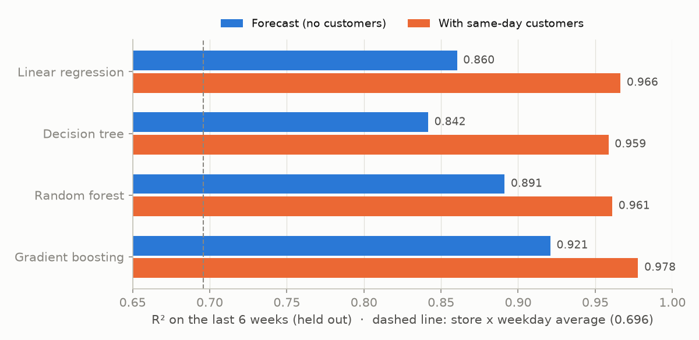
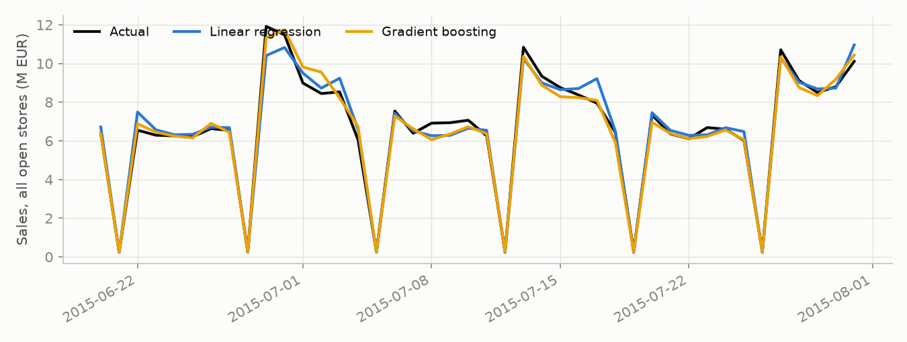
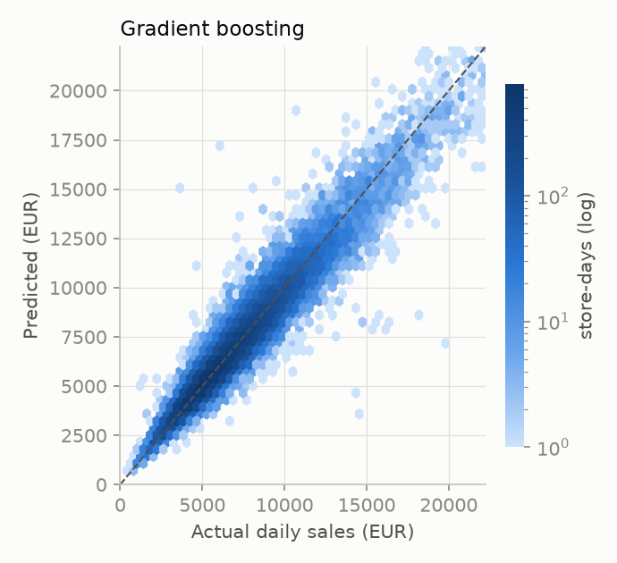
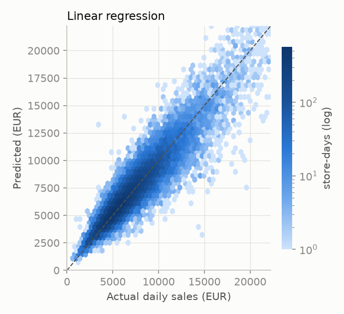

<div align="center">

# 📈 Store Sales Forecast

**Previsión de ventas diarias de 1.115 tiendas Rossmann con cuatro modelos de scikit-learn, evaluados sobre las últimas 6 semanas de datos.**


[Qué hace](#-qué-hace) · [Puesta en marcha](#-puesta-en-marcha-en-3-pasos) · [Requisitos](#-requisitos-del-equipo) · [Modelos](#-modelos) · [Entrenamiento](#-entrenamiento) · [Problemas comunes](#-problemas-comunes)

</div>

---

## ✨ Qué hace

Eliges una tienda y la app predice sus ventas diarias en euros con cuatro modelos: **regresión lineal, árbol de decisión, random forest y gradient boosting**. Solo usan lo que se sabe de antemano: la tienda, la fecha, si hay promoción y los festivos.

| Pestaña | Qué obtienes |
|---|---|
| 📊 **Últimas 6 semanas** | Las ventas reales de la tienda frente a la predicción de cada modelo, día a día, con el error típico diario de cada uno y su desviación en el total de las 6 semanas. Son días que ningún modelo vio al entrenar. |
| 🔮 **Previsión de un día** | Eliges fecha, promoción y festivos, y ves la predicción de los cuatro modelos frente a la media de la tienda para ese día de la semana. |



- Los modelos y el histórico de ventas **se descargan solos** de Hugging Face la primera vez y quedan guardados en un volumen de Docker.
- Todo corre en local, en CPU, sin claves ni `.env`.

---

## 🏁 Puesta en marcha en 3 pasos

> Solo necesitas **[Docker Desktop](https://www.docker.com/products/docker-desktop/)** abierto y **[Git](https://git-scm.com/downloads)**. No hace falta instalar Python ni descargar datos a mano.

### 1️⃣ Clona el repositorio

```bash
git clone https://github.com/JTiiz/iron-kaggle.git
cd iron-kaggle
```

### 2️⃣ Construye y arranca

```bash
docker compose up --build -d
```

⏱️ El primer build tarda un par de minutos. Los siguientes arranques tardan segundos.

### 3️⃣ Abre la app

👉 **http://localhost:8502**

> ℹ️ La **primera** carga tarda unos segundos más: descarga los cuatro modelos (≈ 75 MB) y el histórico de ventas (38 MB). Después todo queda en caché y cada predicción es instantánea.

---

## 💻 Requisitos del equipo

| Recurso | Mínimo | Recomendado | Por qué |
|---|---|---|---|
| 🧠 **RAM** | 2 GB | 4 GB | Con los cuatro modelos y el histórico cargados, el contenedor usa unos 550 MB. |
| 💾 **Disco libre** | 2 GB | 3 GB | Imagen Docker ≈ 1 GB + modelos y datos ≈ 0,1 GB + caché de build. |
| ⚙️ **CPU** | 1 núcleo | 2 núcleos | Predecir las 6 semanas de una tienda con los cuatro modelos tarda menos de 0,1 s. |
| 🎮 **GPU** | No necesaria | — | scikit-learn no usa GPU, ni siquiera para entrenar (2 minutos en un portátil). |
| 🌐 **Internet** | Necesario | — | Para el primer build y la primera descarga de modelos y datos. |

| Software | Notas |
|---|---|
| 🐳 Docker Desktop 4.x+ | En Windows, con el backend **WSL 2**. Incluye `docker compose`. |
| 🔧 Git | Para clonar el repositorio. |

---

## 🧰 Comandos útiles

| Acción | Comando |
|---|---|
| ▶️ Arrancar (sin reconstruir) | `docker compose up -d` |
| 📜 Ver logs en directo | `docker logs -f store-sales-forecast` |
| ⏹️ Parar | `docker compose down` |
| 🔁 Reconstruir tras cambiar código | `docker compose up --build -d` |
| 🗑️ Borrar también modelos y datos descargados | `docker compose down -v` |

---

## 🤖 Modelos

Los cuatro aprenden con los mismos datos (enero de 2013 a junio de 2015) y se evalúan sobre las **mismas últimas 6 semanas** (20 de junio a 31 de julio de 2015, 40.282 días de tienda), que no se usaron ni para entrenar ni para calcular las estadísticas por tienda. Se declaran en [`models/models.yaml`](models/models.yaml).

| Modelo | Hugging Face | R² | RMSPE | RMSE | MAE |
|---|---|---|---|---|---|
| **Gradient boosting** | [jramduran/rossmann-sales-gradient-boosting](https://huggingface.co/jramduran/rossmann-sales-gradient-boosting) | **0,921** | **0,118** | **859 €** | **584 €** |
| **Random forest** | [jramduran/rossmann-sales-random-forest](https://huggingface.co/jramduran/rossmann-sales-random-forest) | 0,891 | 0,142 | 1.007 € | 684 € |
| **Regresión lineal** | [jramduran/rossmann-sales-linear-regression](https://huggingface.co/jramduran/rossmann-sales-linear-regression) | 0,860 | 0,159 | 1.141 € | 795 € |
| **Árbol de decisión** | [jramduran/rossmann-sales-decision-tree](https://huggingface.co/jramduran/rossmann-sales-decision-tree) | 0,842 | 0,176 | 1.216 € | 844 € |
| *Referencia: media de la tienda para ese día de la semana* | — | 0,696 | 0,224 | 1.684 € | 1.251 € |

*RMSPE* es el error porcentual cuadrático medio, la métrica de la competición de Kaggle: 0,118 significa que el error típico de un día es de en torno al 12 %.

<p align="center">
  
</p>

**Cómo se resuelve cada modelo:**
1. Si existe `models/<folder>/` (por ejemplo, un modelo que acabas de entrenar), se usa esa copia local.
2. Si no, se descarga del `hub_id` de Hugging Face.

---

## 🧪 Entrenamiento

El código está en [`training/`](training/) y es reproducible de principio a fin.

| | |
|---|---|
| **Datos** | [Rossmann Store Sales](https://www.kaggle.com/competitions/rossmann-store-sales) (Kaggle): `train.csv` (1.017.209 días de tienda) + `store.csv`. Se leen de una [copia en Hugging Face](https://huggingface.co/datasets/AiiN-aini/rossmann-store-sales) con revisión fija, idéntica byte a byte a la de Kaggle |
| **Filas** | Solo días abiertos con ventas: 804.056 de entrenamiento y 40.282 de test |
| **División** | **Temporal**: las últimas 6 semanas son el test, como en la competición |
| **Objetivo** | `log(1 + ventas)`, para que las tiendas grandes no dominen el error |
| **Variables (21)** | Calendario, promoción y festivos, tipo de tienda, surtido, distancia y antigüedad de la competencia, Promo2, y 4 estadísticas por tienda calculadas **solo con el periodo de entrenamiento** |
| **Hardware** | CPU · **2 minutos** los ocho entrenamientos (4 modelos × 2 escenarios) |

**Dos escenarios.** El reto original de Iron Kaggle daba también el **número de clientes de ese mismo día**, un dato que no se conoce de antemano. Se entrenan los cuatro modelos de las dos formas para comparar:

| Modelo | Previsión (sin clientes) R² | Con clientes del día R² |
|---|---|---|
| Gradient boosting | 0,921 | 0,978 |
| Random forest | 0,891 | 0,961 |
| Regresión lineal | 0,860 | 0,966 |
| Árbol de decisión | 0,842 | 0,959 |

La app usa los modelos **sin clientes**, porque son los que sirven para planificar.

<p align="center">
  
</p>

<p align="center">
  
  
</p>

**Lectura de resultados:**
- 🟢 **Gradient boosting** es el mejor en todas las métricas. Sumando todas las tiendas, su total de las 6 semanas se desvía un **0,8 %** del real, y el total de cada día un 4,4 % de media.
- 🟠 Lo que más pesa es **la propia tienda** (su media por día de la semana y su media general) y **la promoción**. Así lo indican las importancias del random forest.
- 🔵 Saber los clientes del día sube el R² de 0,92 a 0,98, pero entonces ya no es una previsión. Con ese dato hasta la regresión lineal llega a 0,966.
- 🔴 El árbol de decisión queda incluso por detrás de la regresión lineal: un único árbol generaliza peor que un conjunto de ellos.

**Reproducirlo** (requiere [uv](https://github.com/astral-sh/uv)):

```bash
uv sync --group train
uv run --group train python training/train.py      # descarga los datos (38 MB) y entrena
uv run --group train python training/report.py     # gráficas y tabla comparativa
```

`train.py` deja los modelos en `models/rossmann-<modelo>/`, así que la app los usa automáticamente en lugar de los de Hugging Face. Las métricas y las predicciones del test se guardan en `training/reports/`.

> 📓 El notebook de [`notebooks/`](notebooks/) es la exploración original del reto. Sus métricas no son comparables con estas: dividía los datos al azar, en vez de por fecha, y calculaba las medias por tienda con todos los datos, incluido el test. Además, la celda de predicción final usa un modelo que no está definido.

---

## ⚙️ Configuración

Variables de entorno del servicio (en `docker-compose.yml`):

| Variable | Por defecto | Descripción |
|---|---|---|
| `DEFAULT_STORE` | `336` | Tienda seleccionada al abrir la app. Su error está cerca de la mediana de todas las tiendas. |
| `MODELS_ROOT` | `/app/models` | Carpeta donde se buscan modelos locales antes de ir a Hugging Face. |

---

## 🩺 Problemas comunes

<details>
<summary><b>❌ <code>Cannot connect to the Docker daemon</code></b></summary>

Docker Desktop no está abierto. Ábrelo, espera a que indique *Engine running* y repite el comando.
</details>

<details>
<summary><b>❌ <code>port is already allocated</code> (puerto 8502 ocupado)</b></summary>

Otro proceso usa el puerto 8502. Cambia el mapeo en `docker-compose.yml`, por ejemplo a `"8503:8501"`, y entra por `http://localhost:8503`.
</details>

<details>
<summary><b>❌ La primera carga se queda en "Downloading..."</b></summary>

La app está descargando los modelos y el histórico de Hugging Face. Comprueba tu conexión y mira el progreso con `docker logs -f store-sales-forecast`. Si falla a mitad, recarga la página: la descarga se reanuda.
</details>

<details>
<summary><b>❌ La previsión de un domingo o un festivo parece rara</b></summary>

La mayoría de tiendas cierran esos días, así que hay pocos ejemplos con los que aprender. La previsión supone que la tienda abre.
</details>

---

## 🛠️ Desarrollo local (sin Docker)

Requiere Python 3.12 y [uv](https://github.com/astral-sh/uv).

```bash
uv sync
uv run streamlit run app.py      # http://localhost:8501
```

---

## 📂 Estructura del proyecto

```text
.
├── app.py                    # App Streamlit: comparación de modelos y previsión de un día
├── forecast/
│   └── features.py           # Variables compartidas por el entrenamiento y la app
├── models/
│   └── models.yaml           # Registro de modelos (local o Hugging Face)
├── .streamlit/config.toml    # Tema de la app
├── Dockerfile                # Build en dos etapas (uv + Python 3.12 slim)
├── docker-compose.yml
├── pyproject.toml            # Dependencias (grupo "train" para entrenar)
├── training/
│   ├── train.py              # Entrena y evalúa los 4 modelos en los 2 escenarios
│   ├── report.py             # Gráficas y tabla comparativa
│   ├── upload_to_hub.py      # Publica los modelos en Hugging Face
│   └── reports/              # Métricas, predicciones del test y gráficas
└── notebooks/                # Exploración original del reto
```
