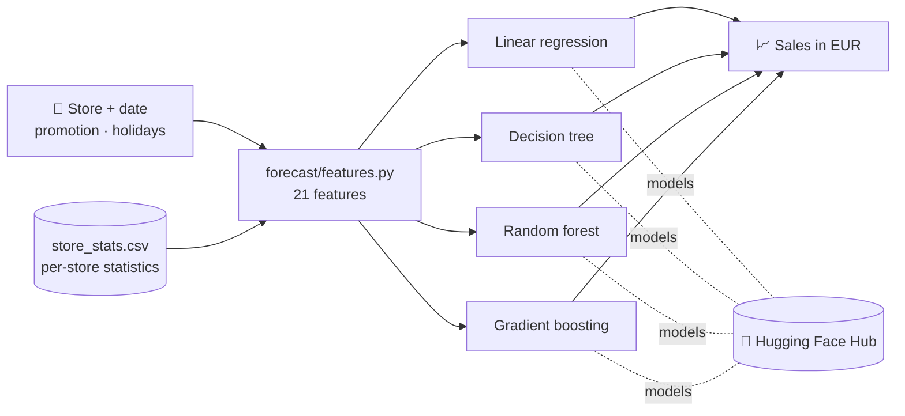

<div align="center">

# 📈 Store Sales Forecast

**Daily sales forecasts for 1,115 Rossmann stores with four scikit-learn models, scored on the last 6 weeks of data.**


[What it does](#-what-it-does) · [Quick start](#-quick-start-in-3-steps) · [Requirements](#-system-requirements) · [Models](#-models) · [Training](#-training) · [Troubleshooting](#-troubleshooting)

</div>

---

## ✨ What it does

Pick a store and the app forecasts its daily sales in euros with four models: **linear regression, decision tree, random forest and gradient boosting**. They only use what is known in advance: the store, the date, whether there is a promotion, and holidays.

| Tab | What you get |
|---|---|
| 📊 **Last 6 weeks: models vs actual** | The store's actual sales against each model's forecast, day by day, with each model's typical daily error and its deviation on the 6-week total. No model saw these days in training. |
| 🔮 **Forecast a day** | Choose a date, promotion and holidays, and see the four models' forecasts against the store's average for that weekday. |



- The models and the sales history **download themselves** from Hugging Face the first time and are kept in a Docker volume.
- Everything runs locally on CPU, with no keys and no `.env`.

---

## 🏁 Quick start in 3 steps

> All you need is **[Docker Desktop](https://www.docker.com/products/docker-desktop/)** running and **[Git](https://git-scm.com/downloads)**. No Python install and no manual data download.

### 1️⃣ Clone the repository

```bash
git clone https://github.com/JTiiz/iron-kaggle.git
cd iron-kaggle
```

### 2️⃣ Build and start

```bash
docker compose up --build -d
```

⏱️ The first build takes a couple of minutes. Later starts take seconds.

### 3️⃣ Open the app

👉 **http://localhost:8502**

> ℹ️ The **first** load takes a few seconds longer: it downloads the four models (≈ 75 MB) and the sales history (38 MB). After that everything is cached and every forecast is instant.

---

## 💻 System requirements

| Resource | Minimum | Recommended | Why |
|---|---|---|---|
| 🧠 **RAM** | 2 GB | 4 GB | With the four models and the history loaded, the container uses about 550 MB. |
| 💾 **Free disk** | 2 GB | 3 GB | Docker image ≈ 1 GB + models and data ≈ 0.1 GB + build cache. |
| ⚙️ **CPU** | 1 core | 2 cores | Forecasting a store's 6 weeks with the four models takes under 0.1 s. |
| 🎮 **GPU** | Not needed | — | scikit-learn does not use a GPU, not even for training (2 minutes on a laptop). |
| 🌐 **Internet** | Required | — | For the first build and the first download of models and data. |

| Software | Notes |
|---|---|
| 🐳 Docker Desktop 4.x+ | On Windows, with the **WSL 2** backend. Includes `docker compose`. |
| 🔧 Git | To clone the repository. |

---

## 🧰 Useful commands

| Action | Command |
|---|---|
| ▶️ Start (without rebuilding) | `docker compose up -d` |
| 📜 Follow the logs | `docker logs -f store-sales-forecast` |
| ⏹️ Stop | `docker compose down` |
| 🔁 Rebuild after changing code | `docker compose up --build -d` |
| 🗑️ Also delete the downloaded models and data | `docker compose down -v` |

---

## 🤖 Models

All four learn from the same data (January 2013 to June 2015) and are scored on the **same last 6 weeks** (20 June to 31 July 2015, 40,282 store-days), which were used neither for training nor for computing the per-store statistics. They are declared in [`models/models.yaml`](models/models.yaml).

| Model | Hugging Face | R² | RMSPE | RMSE | MAE |
|---|---|---|---|---|---|
| **Gradient boosting** | [jramduran/rossmann-sales-gradient-boosting](https://huggingface.co/jramduran/rossmann-sales-gradient-boosting) | **0.921** | **0.118** | **€859** | **€584** |
| **Random forest** | [jramduran/rossmann-sales-random-forest](https://huggingface.co/jramduran/rossmann-sales-random-forest) | 0.891 | 0.142 | €1,007 | €684 |
| **Linear regression** | [jramduran/rossmann-sales-linear-regression](https://huggingface.co/jramduran/rossmann-sales-linear-regression) | 0.860 | 0.159 | €1,141 | €795 |
| **Decision tree** | [jramduran/rossmann-sales-decision-tree](https://huggingface.co/jramduran/rossmann-sales-decision-tree) | 0.842 | 0.176 | €1,216 | €844 |
| *Baseline: the store's average for that weekday* | — | 0.696 | 0.224 | €1,684 | €1,251 |

*RMSPE* is the root mean square percentage error, the Kaggle competition's metric: 0.118 means a typical day's error is around 12%.

<p align="center">
  
</p>

**How each model is resolved:**
1. If `models/<folder>/` exists (for example, a model you have just trained), that local copy is used.
2. Otherwise it is downloaded from its Hugging Face `hub_id`.

---

## 🧪 Training

The code is in [`training/`](training/) and is reproducible end to end.

| | |
|---|---|
| **Data** | [Rossmann Store Sales](https://www.kaggle.com/competitions/rossmann-store-sales) (Kaggle): `train.csv` (1,017,209 store-days) + `store.csv`. Read from a [copy on Hugging Face](https://huggingface.co/datasets/AiiN-aini/rossmann-store-sales) at a fixed revision, byte-for-byte identical to Kaggle's |
| **Rows** | Only open days with sales: 804,056 for training and 40,282 for test |
| **Split** | **Time-based**: the last 6 weeks are the test set, as in the competition |
| **Target** | `log(1 + sales)`, so that large stores do not dominate the error |
| **Features (21)** | Calendar, promotion and holidays, store type, assortment, competitor distance and age, Promo2, and 4 per-store statistics computed **from the training period only** |
| **Hardware** | CPU · **2 minutes** for all eight trainings (4 models × 2 scenarios) |

**Two scenarios.** The original Iron Kaggle challenge also gave the **number of customers on that same day**, which is not known in advance. All four models are trained both ways for comparison:

| Model | Forecast (no customers) R² | With same-day customers R² |
|---|---|---|
| Gradient boosting | 0.921 | 0.978 |
| Random forest | 0.891 | 0.961 |
| Linear regression | 0.860 | 0.966 |
| Decision tree | 0.842 | 0.959 |

The app uses the models **without customers**, because they are the ones that are useful for planning.

<p align="center">
  
</p>

<p align="center">
  
  
</p>

**Reading the results:**
- 🟢 **Gradient boosting** is the best on every metric. Adding up all stores, its 6-week total is off by **0.8%** from the actual one, and each day's total by 4.4% on average.
- 🟠 What weighs most is **the store itself** (its weekday average and its overall average) and **the promotion**, according to the random forest's feature importances.
- 🔵 Knowing the day's customers lifts R² from 0.92 to 0.98, but then it is no longer a forecast. With that information even the linear regression reaches 0.966.
- 🔴 The decision tree falls even behind the linear regression: a single tree generalises worse than an ensemble of them.

**Reproduce it** (requires [uv](https://github.com/astral-sh/uv)):

```bash
uv sync --group train
uv run --group train python training/train.py      # downloads the data (38 MB) and trains
uv run --group train python training/report.py     # charts and comparison table
```

`train.py` saves the models in `models/rossmann-<model>/`, so the app uses them automatically instead of the ones on Hugging Face. Metrics and test predictions are saved in `training/reports/`.

> 📓 The notebook in [`notebooks/`](notebooks/) is the original exploration of the challenge. Its metrics are not comparable with these: it split the data at random instead of by date, and it computed the per-store averages with all the data, test included. Also, its final prediction cell uses a model that is not defined.

---

## ⚙️ Configuration

Service environment variables (in `docker-compose.yml`):

| Variable | Default | Description |
|---|---|---|
| `DEFAULT_STORE` | `336` | Store selected when the app opens. Its error is close to the median of all stores. |
| `MODELS_ROOT` | `/app/models` | Folder searched for local models before going to Hugging Face. |

---

## 🩺 Troubleshooting

<details>
<summary><b>❌ <code>Cannot connect to the Docker daemon</code></b></summary>

Docker Desktop is not running. Open it, wait until it shows *Engine running* and run the command again.
</details>

<details>
<summary><b>❌ <code>port is already allocated</code> (port 8502 in use)</b></summary>

Another process is using port 8502. Change the mapping in `docker-compose.yml`, for example to `"8503:8501"`, and open `http://localhost:8503`.
</details>

<details>
<summary><b>❌ The first load stays on "Downloading..."</b></summary>

The app is downloading the models and the history from Hugging Face. Check your connection and follow the progress with `docker logs -f store-sales-forecast`. If it fails halfway, reload the page: the download resumes.
</details>

<details>
<summary><b>❌ The forecast for a Sunday or a holiday looks odd</b></summary>

Most stores are closed on those days, so there are few examples to learn from. The forecast assumes the store is open.
</details>

---

## 🛠️ Local development (without Docker)

Requires Python 3.12 and [uv](https://github.com/astral-sh/uv).

```bash
uv sync
uv run streamlit run app.py      # http://localhost:8501
```

---

## 📂 Project structure

```text
.
├── app.py                    # Streamlit app: model comparison and one-day forecast
├── forecast/
│   └── features.py           # Features shared by training and the app
├── models/
│   └── models.yaml           # Model registry (local or Hugging Face)
├── .streamlit/config.toml    # App theme
├── Dockerfile                # Two-stage build (uv + Python 3.12 slim)
├── docker-compose.yml
├── pyproject.toml            # Dependencies ("train" group for training)
├── training/
│   ├── train.py              # Trains and evaluates the 4 models in the 2 scenarios
│   ├── report.py             # Charts and comparison table
│   ├── upload_to_hub.py      # Publishes the models on Hugging Face
│   └── reports/              # Metrics, test predictions and charts
└── notebooks/                # Original exploration of the challenge
```
